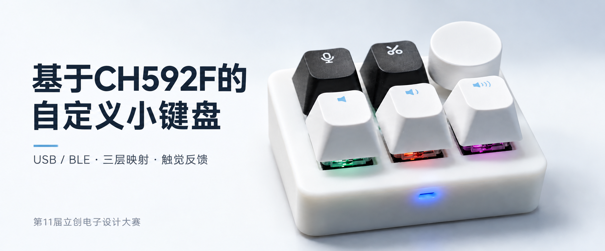
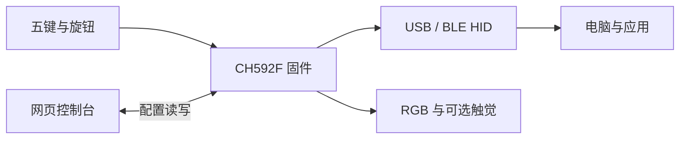
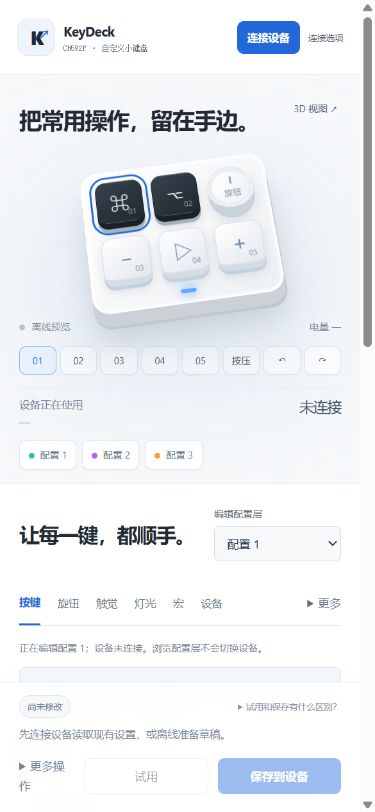

<div align="center">

# KeyDeck

**基于CH592F的自定义小键盘**

五个机械按键，一个旋钮。把快捷键、音量和常用操作留在手边。

[](releases/1.15.0)
[](firmware/README.md)
[](web/README.md)
[](firmware/README.md)

[界面预览](#界面预览) · [本地快速开始](#本地快速开始) · [固件与烧录](firmware/README.md) · [在线控制台](https://jasonbrom.github.io/ch592f-keydeck/) · [设计规范](docs/DESIGN-SYSTEM.md) · [开发与验证](#开发与验证)



</div>

> [!NOTE]
> KeyDeck 是工程代号，正式项目名称为「基于CH592F的自定义小键盘」。本仓库基于 1.15 功能基线整理，提供带震动和无震动两种构建。新整理版本仍需分别上板验收；在线地址在首次 Pages 部署完成后生效。

## 项目简介

KeyDeck 使用 CH592F 处理五键和旋钮输入，通过 USB 或 BLE 发送 HID 报告。浏览器控制台用于配置按键、宏、旋钮与灯光，保存到设备后可以独立运行。

固件、网页、构建脚本和测试在同一仓库维护。带震动版支持 DRV2605L + AAC0809；无震动版跳过马达驱动与 I²C 初始化，并移除 HID 触觉报告。两版使用相同的 1024 字节配置格式。

竞赛标题：**#第11届立创电赛#基于CH592F的自定义小键盘**。



## 界面预览

以下截图来自本地浏览器的离线页面，不显示虚构设备读数。封面以实物照片为参考生成，仅用于项目介绍。

### 浅色控制台

点选左侧按键进入对应编辑项。按键、旋钮、触觉、灯光、宏和设备设置分开显示；底部统一处理试用与保存。


<details>
<summary>查看固件下载与手机布局</summary>

### 两种固件


### 手机布局

<p align="center"></p>

</details>

## 核心能力

| 部分     | 功能                                                          |
| -------- | ------------------------------------------------------------- |
| 按键映射 | 三层配置；快捷键、多媒体、鼠标、切层、Fn 组合                 |
| 旋钮     | 原生 Windows 轮盘、系统音量、鼠标滚轮、自定义映射             |
| 宏       | 8 个槽，每槽最多 16 步；录制、步骤编辑、间隔与重复模式        |
| 灯光     | 五键 RGB 背光、独立状态灯、配置层指示、Windows LampArray 接口 |
| 可选触觉 | 内置效果、8 槽序列、16 段 RTP 曲线、事件绑定与校准            |
| 配置     | 离线编辑与 JSON 导入导出；CRC 校验、原子应用、保存后完整回读  |

切换编辑层不会切换设备运行层。旋钮用途、宏槽、灯光与触觉设置为三层共用，页面会提示影响范围。

## 平台与版本

| 环境                 | 用途               | 说明                                                         |
| -------------------- | ------------------ | ------------------------------------------------------------ |
| CH592F / 带震动版    | 完整固件           | DRV2605L + AAC0809 LRA，触觉效果与校准                       |
| CH592F / 无震动版    | 不装震动组件的硬件 | 不访问马达驱动，保留改键、旋钮、宏与灯光                     |
| 桌面 Chrome / Edge   | 连接与配置         | WebHID / Web Bluetooth 的可用性取决于系统和浏览器            |
| GitHub Pages / HTTPS | 在线静态控制台     | 支持浏览器设备接口，不运行 Python 后端                       |
| Windows 本地控制台   | 已配对蓝牙管理     | Python + Bleak / WinRT；同源本地服务                         |
| Linux / WSL Ubuntu   | 固件开发           | WCH MounRiver GCC 8.2.0、Make、Python 3；交叉测试需 Node 22+ |

## 本地快速开始

Windows 双击 `web/StartConsole.cmd`，或在终端中运行：

```sh
cd web
python start-console.py
```

用桌面 Chrome / Edge 打开 `http://localhost:8792/`。

1. 点击「连接设备」。首次连接时，从「连接选项」选择 USB 或蓝牙并授权。
2. 控制台读取设备配置；若已有未保存草稿，会保留草稿。
3. 点击按键或输入编号，选择动作。切换顶部配置层可以浏览其他映射。
4. 点击「试用」临时应用，或「保存到设备」写入 Flash 并完整回读校验。

Windows 已配对蓝牙需要本地服务；启动器可将 `requirements-windows.txt` 的依赖安装到 `.runtime/`。不需要该方式时，也可使用普通静态 localhost 或 HTTPS 站点。不要直接通过 `file://` 打开 HTML。

## 固件与烧录

预编译文件在 [`releases/1.15.0`](releases/1.15.0)，校验信息见 [`manifest.json`](releases/1.15.0/manifest.json)。网页的固件页也提供两版 HEX。

| 构建   | HEX                                                  | BIN                                                  |
| ------ | ---------------------------------------------------- | ---------------------------------------------------- |
| 带震动 | [下载](releases/1.15.0/KeyDeck-CH592F-haptic.hex)    | [下载](releases/1.15.0/KeyDeck-CH592F-haptic.bin)    |
| 无震动 | [下载](releases/1.15.0/KeyDeck-CH592F-no-haptic.hex) | [下载](releases/1.15.0/KeyDeck-CH592F-no-haptic.bin) |

使用 WCH 官方 ISP 工具，选择 CH592F，优先载入 HEX。按住 BOOT 并复位进入 USB ISP，下载后松开 BOOT 再复位。保留 DataFlash，避免清除配置和蓝牙配对；切换版本前建议导出 JSON。

自行构建：

```sh
cd firmware
bash scripts/fetch_toolchain.sh
make -j4 VARIANT=haptic CROSS_COMPILE="$HOME/.cache/c5-dial-tools/riscv-none-embed-gcc-8-linux-1.91/bin/riscv-none-embed-"
make -j4 VARIANT=no-haptic CROSS_COMPILE="$HOME/.cache/c5-dial-tools/riscv-none-embed-gcc-8-linux-1.91/bin/riscv-none-embed-"
cd ..
node scripts/package-release.mjs
```

两种构建分别使用 `firmware/build/haptic/` 和 `firmware/build/no-haptic/`，共用源码。必须使用支持 WCH 快速中断 ABI 的工具链。引脚、芯片选项、版本差异和详细步骤见 [固件说明](firmware/README.md)。

## 项目结构

```text
.
├── web/
│   ├── public/             网页源码、设备协议与本地模型资源
│   │   ├── config/         改键、宏、灯光、触觉与连接模块
│   │   └── downloads/      两版固件和构建信息
│   ├── scripts/            静态打包与资源路径检查
│   ├── tests/              浏览器逻辑和 Python 本地服务测试
│   └── start-console.py    本地 HTTP 与 Windows 蓝牙服务
├── firmware/
│   ├── core/               配置、映射、宏与触觉逻辑
│   ├── board/              引脚、编码器、灯光、存储与马达驱动
│   ├── platform/ch592/     USB、BLE 和主循环
│   ├── features/           HID 报告与描述符生成器
│   ├── include/            公共接口与配置结构
│   ├── tests/              主机测试及 C / JS 交叉验证
│   └── vendor/             固定版本 WCH SDK，保留许可与哈希
├── releases/               HEX / BIN 与 SHA-256
├── docs/                   设计、协议、发布和验证记录
└── .github/workflows/      双版本 CI 与 GitHub Pages
```

构建产物 `firmware/build/`、`web/dist/`、本地蓝牙依赖、日志和缓存不提交 Git。README 预览图保存在 `docs/images/`，随文档维护。

## 开发与验证

网页运行不依赖 Node 或 CDN。开发测试使用 Node.js 22 或更新版本：

```sh
cd web
npm test
npm run build
cd ..
python -m unittest discover -s web/tests -p 'test_*.py'
bash firmware/scripts/verify_host.sh
bash firmware/tests/run_integration_tests.sh
```

需要格式化源码时，在 `web/` 中执行 `npm install`、`npm run format`。生产网页的打包脚本只使用 Node 内置模块。

当前验证包含 61 项网页测试、6 项本地服务测试、固件主机验证，以及主协议 34 项 C / JS 交叉检查。带震动 BIN 与原来已实测的 1.15 镜像逐字节一致；无震动版已通过能力位、HID 描述符、命令拒绝与校准配置保留检查。

详细范围见 [验证记录](docs/VERIFICATION.md)，配置格式见 [协议速查](docs/PROTOCOL.md)，界面规则见 [设计规范](docs/DESIGN-SYSTEM.md)。

## GitHub Pages

目标地址：**[jasonbrom.github.io/ch592f-keydeck](https://jasonbrom.github.io/ch592f-keydeck/)**。

首次推送 `main` 后，在 [Settings → Pages](https://github.com/jasonBrom/ch592f-keydeck/settings/pages) 将 Source 设为 **GitHub Actions**，然后运行 [Deploy console to GitHub Pages](https://github.com/jasonBrom/ch592f-keydeck/actions/workflows/pages.yml)。

部署任务从当前提交编译两版固件，更新网页下载文件，检查相对路径，再发布 `web/dist/`。Windows 已配对蓝牙仍需本地启动器；在线页不探测本地蓝牙服务。完整步骤见 [发布说明](docs/GITHUB.md)。

## 已知边界

- 新整理构建尚未分别上板验收；软件测试不替代实物验证。
- 深睡和 USB 远程唤醒尚未实现，闲置熄灯不能作为续航结论。
- 电量由电压估算，Windows 轮盘与动态灯光行为取决于系统和应用。
- 固件使用原工程的实验 USB 身份，控制台不是固件烧录工具。
- 本目录是独立整理版，原工程和历史文件保留在原位置。

## 许可证与来源

本项目是在赛题复刻基础上的适配与扩展，不能将引用的电路、代码和模型声明为原创。自有代码的统一许可证尚待作者指定，见 [许可状态](LICENSE.md)。

WCH SDK、Three.js 与模型资源保留各自许可和来源。详见 [第三方说明](THIRD_PARTY_NOTICES.md)。文档结构参考作者的 [C2000MAX-UI](https://github.com/jasonBrom/C2000MAX-UI)，使用居中简介、截图、能力表格与独立开发文档组织内容。
